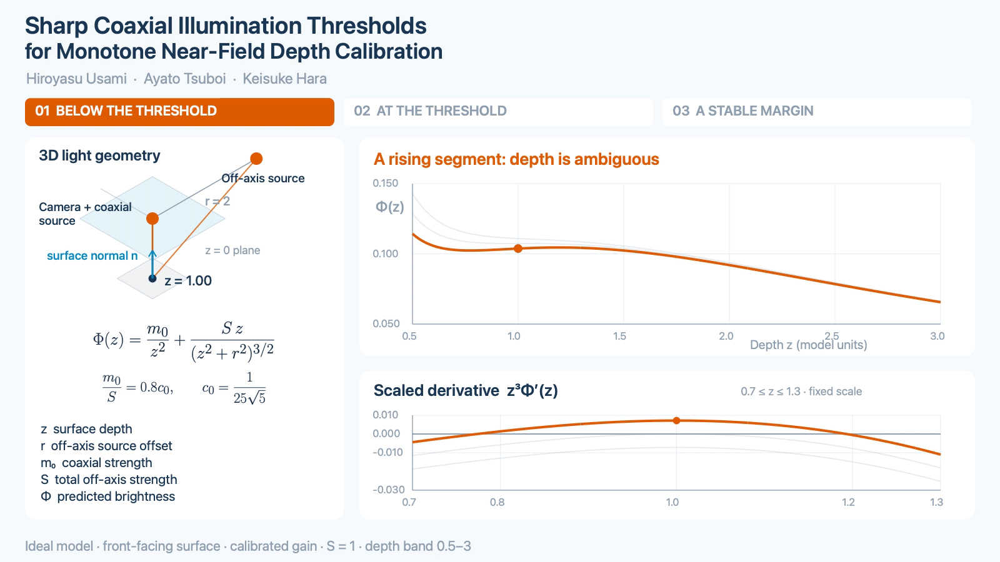
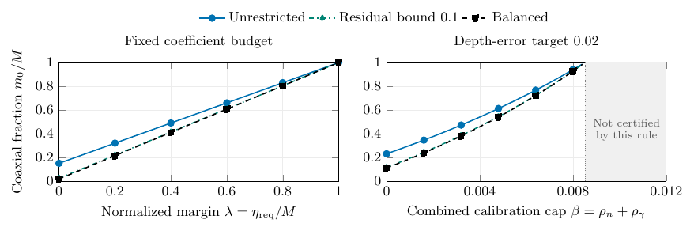

# Illumination Balance and Sharp Thresholds for Near-Field Depth Calibration

Hiroyasu Usami · Ayato Tsuboi · Keisuke Hara

[Read the manuscript (PDF)](manuscript.pdf) · [LaTeX source](manuscript_source.zip) · [Code and results](code-and-results.zip)

Code, reference results, figures and animation for the paper. The analysis gives sharp coaxial-to-off-axis coefficient thresholds for unique scalar depth calibration and bounds depth error above the threshold.

For isotropic illumination and a 45° normal cone:

| Layout class | Sharp coaxial-to-off-axis coefficient ratio |
|---|---:|
| Unrestricted layouts | 0.17678 |
| Common radius, weighted-centroid residual at most 0.1 | 0.024061 |
| Weighted balanced common-radius layouts | 0.017889 |

The unrestricted and balanced class-wide thresholds differ by a factor of **9.8821** in calibrated source coefficients. A normalized weighted-centroid residual of 0.1 gives the intermediate threshold 0.024061. This residual is the norm of the strength-weighted source centroid divided by the common radius.

One intensity recovers distance for a camera-axis point with known fixed normal and gain under local Lambertian clamping. A reference patch translated along the camera axis with its orientation fixed provides one calibration setting. Source positions and coefficients are calibrated.



## Fixed budget and calibration tolerances

With the total calibrated source coefficient fixed at one, a depth band of [0.5, 3], measurement error at most 0.0001 and depth tolerance 0.02 give these sufficient coaxial fractions:

| Layout class | Nominal calibration | Normal/gain uncertainty included |
|---|---:|---:|
| Unrestricted | 0.23134 | 0.45600 |
| Weighted-centroid residual at most 0.1 | 0.11671 | 0.36618 |
| Balanced | 0.11136 | 0.36192 |

The uncertainty column uses unit-normal Euclidean distance at most 0.002 and relative gain error at most 0.001. The normal cone has slope bound one, source radius two and nominal gain one. Positions and relative off-axis weights stay fixed as the budget is allocated.

Across three layout classes and twelve calibration-cap pairs, a full-band certificate yields allocations for eighteen of the 36 settings. Their 1,152 numerical inversion controls have maximum observed depth error 0.014970. The remaining eighteen settings are retained as uncertified by this sufficient rule. The derivation is in `docs/DESIGN_ROBUSTNESS.pdf` inside the archive.



## Check a known operating band

For isotropic sources, let $T$ bound the transverse-to-axial normal ratio, $r_{\max}$ be the largest source radius, and $z_{\min}$ the start of the depth band. The condition

$$z_{\min}\ge r_{\max}\frac{3T+\sqrt{9T^2+8}}4$$

ensures strict decrease on the band with zero coaxial coefficient. At $T=1$, the cutoff is approximately $1.7808$. This is a direct consequence of the paper's derivative formula; the derivation is in `docs/OPERATING_BAND_CHECK.md` inside the archive.

## Observation count and calibration inputs

For a balanced common-radius array, two exposures at unchanged depth, normal and gain eliminate the latter two calibration inputs when every incidence factor is nonnegative. Source geometry, relative coefficients and the aligned emission exponent remain known. Each exposure uses coefficient budget $M$, giving $2M$ across the pair.

Let $r$ be the common source radius, $\mu$ the emission exponent, $k=\mu+3$, $m_{0j}$ the coaxial coefficient and $S_j=M-m_{0j}$ the off-axis total in exposure $j$. With $0<m_{01}<m_{02}<M$, define $D=M(m_{02}-m_{01})$. The measured intensities $I_1,I_2$ give

$$U=\frac{S_1I_2-S_2I_1}{D},\qquad V=\frac{m_{02}I_1-m_{01}I_2}{D},\qquad q=V/U,$$

$$z=\frac{r q^{1/k}}{\sqrt{1-q^{2/k}}}.$$

Here $U$ is the shared radiometric scale and $q\in(0,1)$ encodes depth. The nonnegative-incidence condition is guaranteed over a normal cone of slope bound $T$ when the depth band starts at $z_{\min}\ge rT$. One positive intensity is insufficient with a free positive gain.

Partial clamping changes the conclusion. An explicit isotropic construction at depths $1/2$ and $2/5$ gives the same intensity for every allocation between the coaxial source and one fixed off-axis pattern. Repeating those allocations cannot distinguish the depths, even though the canonical pair of allocations both exceed the one-observation monotonicity threshold. The off-axis relative weights stay fixed in this construction.

The study contains 108 noiseless pairs and 864 noisy pairs. The decoder receives no normal, gain or true depth. For target depth error 0.02:

| Noise cap | Maximum depth error | Maximum error bound | Target met | Target certified |
|---|---:|---:|---:|---:|
| $10^{-6}$ | 0.0027600 | 0.0029818 | 432/432 | 432/432 |
| $10^{-4}$ | 0.24545 | 0.30199 | 384/432 | 216/432 |

All observed errors satisfy their individual bounds. See `docs/TWO_OBSERVATION_CALIBRATION.pdf` in the archive for the derivation, error certificate and exact collision.

## Related work

[McGunnigle et al. (2011)](https://doi.org/10.1117/1.3575651) combine [coaxially augmented photometric stereo](https://doi.org/10.1049/iet-cvi.2009.0038) with laser height profiles to recover discontinuous surfaces. The present analysis studies the scalar depth response, sharp illumination coefficient thresholds, and inverse sensitivity.

## Reproduce

Use Python 3 and its standard library. From a fresh repository checkout, unpack the source archive and run:

```sh
python3 -m zipfile -e code-and-results.zip .
mkdir reproduced
mkdir reproduced/isotropic reproduced/angular
cp code/radiometry.py code/run_validation.py code/balanced_controls.py reproduced/isotropic/
(cd reproduced/isotropic && python3 run_validation.py && python3 balanced_controls.py)
cp code/angular_controls/angular_controls.py code/angular_controls/EFFECTIVE_SPEC.json reproduced/angular/
(cd reproduced/angular && python3 angular_controls.py)
python3 code/design_case/design_case.py --output-dir reproduced/design_case
python3 code/residual_balance/residual_controls.py --spec code/residual_balance/SPEC.json --threshold code/figure_sources/threshold.csv --output reproduced/residual_balance
python3 code/budget_robustness/design_controls.py --spec code/budget_robustness/SPEC.json --output reproduced/budget_robustness
python3 code/budget_robustness/matched_comparison.py --rows reproduced/budget_robustness/ROWS.csv --output reproduced/budget_robustness/MATCHED_COMPARISON.json
python3 code/operating_band/verify_band_check.py --output reproduced/BAND_CHECK.json
python3 code/two_observation/two_observation_controls.py --spec code/two_observation/SPEC.json --output reproduced/two_observation
```

Computed coefficients and depth errors are shown to five significant figures; the archive preserves full precision. The commands use fresh output directories. The design-case CLI reads its adjacent `SPEC.json`.

Reference results are grouped in:

- `code/RESULTS.json`: isotropic irradiance, derivative, sharpness, and inversion controls.
- `code/BALANCED_RESULTS.json`: 40 balanced-array controls.
- `code/angular_controls/RESULTS.json`: exact rational root counts, 80-digit numerical coefficient evaluation, and 36 controls at exponent 1.
- `code/design_case/ROWS.json` and `code/design_case/SUMMARY.json`: 20 threshold-versus-margin observations.

- `code/residual_balance/ROWS.json`, `SUMMARY.json`, and `tolerance.csv`: 21 imperfect-balance examples and the common-radius residual curve. The geometry is fixed in the script and described in `SPEC.json`.
- `code/budget_robustness/`: frozen specification, exact certificates, all 3,456 controls and Figure 4 inputs.
- `code/two_observation/`: 108 clean and 864 noisy pairs, exact clamped collision and frozen specification.

## Figures and animation

Vector figures and CSV inputs are in `code/figure_sources/`. With LaTeX, `standalone`, TikZ, and PGFplots installed, run `pdflatex -halt-on-error figure1.tex` there; repeat for `figure2.tex`, `figure3.tex`, and `figure4.tex`.

To rebuild the GIF and silent MP4 on macOS, install Swift, LaTeX, FFmpeg, and Python 3, then run `(cd code/animation && zsh reproduce.sh)`. The script prints the output directory.

For citation, use [CITATION.bib](CITATION.bib).

Code license: to be specified.
